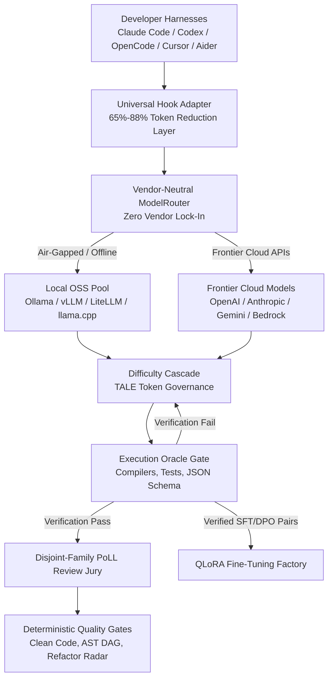
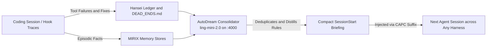

# Kaizen Engineering Kit v4.0 (`kaizen-engineering-kit`)

**Plug-and-Play Deterministic AI Engineering Toolkit for Claude Code, OpenAI Codex CLI, ChatGPT/OpenAI, OpenCode, Cursor, Aider, Continue, and Local OSS (`Ollama` / `vLLM` / `LiteLLM` / `llama.cpp`) — Model- and Vendor-Agnostic.**

[](LICENSE)
[](pyproject.toml)
[](install.py)
[](docs/HARNESS_GUIDE.md)

`kaizen-engineering-kit` transforms stochastic AI coding assistants into deterministic, execution-verified engineering systems. It wraps any local open-weight model or commercial API with **zero-LLM AST/architecture gates**, **65%–88% token-reduction hooks**, **5-stage execution-verified model cascades**, **disjoint-family Panel-of-LLM (PoLL) review juries**, and an **Execution-Oracle Best-of-N QLoRA fine-tuning factory**.

---

## Architecture & Plug-and-Play Flow



---

## 30-Second Quick Start

### 1. Install (Zero Mandatory Runtime Dependencies for Core CLI & Gates)

```bash
# Editable install from repository root
pip install -e .

# Auto-detect and configure installed harnesses non-destructively (preserves existing auth/keys)
python3 install.py --harness auto

# Verify health and run deterministic offline self-tests
kaizen-kit doctor --self-test
```

### 2. Choose Your Runtime (Any Model or Provider)

#### (A) Pure Local OSS (`Ollama` / `vLLM` / `LiteLLM` — 100% Offline, $0 API Cost)
```bash
export KAIZEN_PROVIDER="ollama"
export KAIZEN_OFFLINE="1"
export OLLAMA_HOST="http://127.0.0.1:11434"
export KAIZEN_DEFAULT_MODEL="qwen3-coder:30b-a3b"

ollama pull qwen3-coder:30b-a3b
kaizen-kit check .
```

#### (B) OpenAI / Codex CLI (`gpt-5.4` / `gpt-5.3-codex` / `gpt-5` / `o3`)
```bash
export KAIZEN_PROVIDER="openai"
export OPENAI_API_KEY="sk-proj-..."
export KAIZEN_DEFAULT_MODEL="gpt-5.4"

python3 install.py --harness codex
kaizen-kit check .
```

#### (C) Anthropic / Claude Code (`claude-sonnet-5-5` / `claude-opus-5-5` / `claude-haiku-5-5`)
```bash
export KAIZEN_PROVIDER="anthropic"
export ANTHROPIC_API_KEY="sk-ant-..."
export KAIZEN_DEFAULT_MODEL="claude-sonnet-5-5"

python3 install.py --target claude
kaizen-kit check .
```

#### (D) Hybrid Multi-Provider Pool (Local OSS + OpenAI / Anthropic / Optional Gemini)
```bash
export KAIZEN_PROVIDER="auto"
# Automatically routes confidential code to local OSS and public/sanitized tasks across configured providers
kaizen-kit carbon status
```

---

## Core Capabilities Matrix

### 1. Five Open-Source Engineering Levers

| Lever | Implementation Module | What It Delivers |
| :--- | :--- | :--- |
| **1. Constrained Decoding (`XGrammar` / `GBNF`)** | `kaizen_kit.localmodels` / `kaizen_kit.adk_agents` | Enforces 100% schema-valid JSON, tool calls, and diff grammars at token sampling time on `vLLM` (`xgrammar`) and `llama.cpp` (`GBNF`), eliminating malformed JSON retries. |
| **2. Hybrid Code RAG + Document OCR** | `kaizen_kit.gates.symbol_rag_indexer` / `crates/radar-core` | Combines native Rust AST graph indexing, SQLite FTS5 / BM25 lexical search, and LanceDB vector embeddings with Reciprocal Rank Fusion (RRF) and layout-aware OCR ingestion. |
| **3. Distributed Spot & `llama.cpp` RPC Orchestration** | `kaizen_kit.gpu_burst_orchestrator` / `kaizen_kit.mini_pool` | Tensor-splits 32B–70B+ models across heterogeneous `llama.cpp` RPC nodes or scales ephemeral Spot GPU pools (`g4dn` / `g6e`) with automatic scale-to-zero (`$0` idle cost). |
| **4. Best-of-N Execution-Oracle + QLoRA Factory** | `kaizen_kit.qlora_pipeline` | Samples `N` candidates, filters via compiler/test/AST `ExecutionOracleGate`, mines verified SFT winners (`y_w`) and hard-negative DPO pairs (`y_l`), and exports `vLLM` + `GGUF` LoRA adapters. |
| **5. Streaming Guardrails & Voice-to-Action** | `kaizen_kit.guardrails` | Real-time streaming secret/PII interception (`DeterministicVault`), loop abort guards, and Hybrid-VAD voice-to-action command dispatch with local `whisper-large-v3-turbo` fallback. |

### 2. Six Token-Reduction Techniques (65%–88% Savings)

Detailed in [docs/TOKEN_REDUCTION.md](docs/TOKEN_REDUCTION.md):
1. **CAPC Prefix Ordering & Dynamic-Only Compression**: Locks immutable system/schema prefixes at byte `0` for `75%–90%` KV cache hit rates.
2. **Observation Masking (`>80L`) & Lossless Test Distillation**: Compresses verbose build/test logs into exact failing assertions (`70%–92%` stdout reduction).
3. **TALE Dynamic Token-Budget Policy**: Caps reasoning and output tokens proportionally to task difficulty (`45%–68%` output token savings).
4. **Zero-LLM AST Skeleton Extractor (`~80%`)**: Extracts structural signatures without function bodies via `kaizen-kit skeleton`.
5. **KV-Cache `Q8_0` Quantization & Prefix Caching**: Halves KV VRAM (`-ctk q8_0 -ctv q8_0`) and enables `--enable-prefix-caching` + GPU `EAGLE-3` speculative decoding.
6. **Voice Hybrid VAD & Sliding-Window Compression**: Saves `~25 tok/sec` (`1,500 tok/min`) during silence and bounds long sessions to `<24k` tokens.

### 3. Clean Architecture & Senior Review Gates (Zero LLM Tokens)

- **Clean Code Gate (`check_clean_code.py`)**: Enforces cognitive complexity `<= 10`, guard clauses over nested pyramids, and deep modules.
- **Abstract AST & Provenance Gate (`verify_provenance.py` & `arch_audit.py`)**: Enforces bounded-context isolation (`INV-ISOLATION`), Law of Demeter provenance (`INV-PROVENANCE`), zero synthetic production literals (`INV-NO-SYNTHETIC-LITERAL`), and immutable compile-time schemas (`INV-COMPILE-TIME-SCHEMA`).
- **Senior Review Lint (`senior_review_lint.py`)**: Deterministically catches silent exception swallowing, unbounded timeouts, N+1 loops, and concurrency hazards before code review.
- **L1–L4 Parity Regression Gate (`parity_gate.py`)**: Verifies schema parity, row counts, non-null field coverage, and latency invariants across service migrations.

### 4. Seven Canonical Engineering Codices (`assets/references/codices/`)

Distilled, token-dense architectural references accessible offline via `kaizen-kit docs codex <name>`:
1. `01-clean-code-complete-codex.md` — Functions, naming, cognitive complexity, and cohesion invariants.
2. `02-clean-architecture-complete-codex.md` — Dependency inversion, hexagonal boundaries, and domain isolation.
3. `03-refactoring-guru-66-and-22-smells.md` — Catalog of 22 code smells mapped to 66 deterministic refactorings.
4. `04-gof-22-patterns-and-anti-traps.md` — Gang of Four structural/behavioral/creational patterns and anti-pattern traps.
5. `05-rust-aposd-ddd-official-codex.md` — Rust API Guidelines, typestate invariants, zero-primitive newtypes, and APOSD deep modules.
6. `06-effective-java21-spring-loom-codex.md` — Effective Java 21, Project Loom virtual threads, ArchUnit, and RFC 9457 ProblemDetail.
7. `07-aws-ddia-toc-observability-codex.md` — DDIA distributed systems invariants, OpenTelemetry FinOps, and Theory of Constraints.

---

## Model Matrix & Routing Strategy

`kaizen-engineering-kit` uses a **6-layer Sparse-MoE + Micro-Model Army** (`kaizen_kit.carbon_orchestrator`) so everyday coding, triage, guardrails, and memory consolidation run cheaply on CPU/local GPUs while only hard architectural or unresolved escalations hit frontier APIs.

| Layer / Role | Active Models | How It Is Used |
| :--- | :--- | :--- |
| **Layer 0 — Micro Classifiers, Safety & Voice** | `qwen3-guard-0.6b`, `qwen3-guard-stream-0.6b`, `granite-4-h-tiny`, `bitnet-2b`, `whisper-large-v3-turbo`, `kokoro-82m` | Sub-50ms input/output/streaming secret & prompt-injection rails, tool-call arg inspection, and local Hybrid-VAD ASR/TTS. |
| **Layer 0/B — Hybrid RAG & Document OCR** | `bge-m3`, `qwen3-embed-0.6b`, `qwen3-reranker-0.6b`, `granite-docling-258m`, `docling-v2`, `olmocr-2-7b`, `gemma-4-12b-unified` | Reciprocal Rank Fusion (BM25 + 1-bit AST sketch + dense embeddings) + cross-encoder reranking + PDF/screenshot parsing. |
| **Layer 1 — Fast Triage & Structured JSON** | `qwen3.5-4b`, `ling-mini-2.0`, `glm-4.7-flash` | Constrained JSON/diff extraction (`XGrammar`/`GBNF`), file selection, Voice-to-Action parsing, and **AutoDream** consolidation. |
| **Layer 2 — Primary Sparse-MoE Coders** | `qwen3-coder-30b-a3b` *(3B active/tok)*, `qwen3.5-35b-a3b` *(3B active/tok)*, `gemma-4-26b-a4b` | High-throughput CPU (`m7g` / `llama.cpp`) & GPU (`vLLM`) code generation, refactoring, RCA, and 3-judge disjoint PoLL juries. |
| **Layer 3 — Frontier / Cloud APIs (Optional)** | OpenAI (`gpt-5.4`, `gpt-5.3-codex`, `gpt-5`, `o3`, `o4-mini`, `gpt-4.1`), Anthropic (`claude-sonnet-5-5`, `claude-opus-5-5`, `claude-haiku-5-5`, `claude-fable-5`, `claude-*-4`), Gemini (`gemini-4-neon`, `gemini-4-carbon`, `gemini-4-argon`, `gemini-4-hydrogen`, `gemini-decision-1`), Bedrock, OpenAI-Compat (`deepseek-v3`/`r1`, `grok-code-fast`, `openrouter/*`) | Escalated only when `ExecutionOracleGate` fails or tasks require deep multi-repo synthesis (`DataResidencyGate` blocks confidential code from public APIs). |
| **Layer 4/5 — Ephemeral Spot GPU & RPC** | `Qwen3-235B-A22B` (`distributed_256gb` `llama.cpp` RPC), `Qwen3-32B-AWQ`, **5-Adapter MoE LoRA Portfolio** | Scale-to-zero (`$0` idle) Spot burst for 235B deep audits and Best-of-N QLoRA training (`lora-java-spring-craft`, `lora-rust-vector-parity`, `lora-vue-dashboard-ui`, `lora-system-rca-triage`, `lora-openapi-contract-guard`). |

---

## AutoDream & MIRIX Continual Memory Consolidation

Instead of repeating the same debugging dead-ends across sessions, `kaizen-engineering-kit` combines **MIRIX Multi-Store Memory** (`kaizen_kit.mirix_memory`), **Hansei Ledger** (`kaizen_kit.gates.hansei_ledger`), and **AutoDream** (`ling-mini-2.0` via FastMCP `kaizen_autodream`):



- **Zero-Repeat Dead Ends (`DEAD_ENDS.md`)**: Failed hypotheses, broken flags, and hardware/quota traps are logged once and injected at `SessionStart` so subsequent sessions never re-hit the same trap.
- **Sleep-Cycle Consolidation (`kaizen_autodream` / `memory_autodream`)**: Periodically prunes stale episodic entries, merges duplicate architectural lessons into `kaizen_ledger.json`, and keeps the injected briefing under strict token budgets.
- **Night-Shift Autonomous Runs (`kaizen-kit carbon night-shift`)**: Partitions queued tasks automatically across 5+ lanes:
  - **Local OSS Lane (`ec2_local`)**: AutoDream memory consolidation & Best-of-N code synthesis ($0 overnight API cost).
  - **OpenAI Batch Lane (`openai_batch`)**: Async 50%-discounted `/v1/batches` for GPT-5.4, GPT-5, and o3.
  - **Anthropic Batch Lane (`anthropic_batch`)**: Async 50%-discounted `/v1/messages/batches` for Claude Sonnet 5.5 and Opus 5.5.
  - **Gemini Batch & Flex Lanes (`gemini_batch` / `gemini_flex`)**: 50%-discounted execution stackable with Context Caching.

---

## 50+ Model Catalog & 6-Layer Compute Matrix

The toolkit orchestrates **50+ local open-weight and frontier cloud models** without vendor lock-in. Full specifications, memory footprints, hardware targets, and licensing details are available in **[`docs/MODEL_CATALOG.md`](docs/MODEL_CATALOG.md)**:

- **Layer 0 (CPU Guards & OCR, <1GB)**: `prompt-guard-deberta`, `qwen3-guard-0.6b`, `bge-m3`, `qwen3-reranker-0.6b`, `granite-docling-258m`, `whisper-large-v3-turbo`, `kokoro-82m`.
- **Layer 1 (Micro Edge & Skeletons, <=4B)**: `qwen3.5-4b`, `nemotron-nano-9b-v2`, `bitnet-2b` (1.58-bit ternary), `gemma-4-e2b`.
- **Layer 2 (Always-On CPU Sparse-MoE, <=3.8B Active)**: `qwen3-coder-30b-a3b`, `qwen3.5-35b-a3b`, `nemotron-3-nano-30b-a3b`, `glm-4.7-flash`, `ling-mini-2.0` (AutoDream engine), `gemma-4-26b-a4b`.
- **Layer 3 (Day Managed Frontier)**: `claude-sonnet-5-5`, `claude-opus-5-5`, `claude-haiku-5-5`, `claude-fable-5`, `gemini-4-hydrogen`, `gemini-4-carbon`, `gemini-decision-1`.
- **Layer 4 (Ephemeral Spot GPU Burst, $0 Idle)**: `nemotron-super-49b`, `deepseek-r1-32b-awq`, `qwen3-32b-awq`, `qwen3-coder-next`, `qwen3-235b-a22b-rpc` (16-node distributed).
- **Layer 5 (Frontier Night Batch)**: `gpt-5.4`, `gpt-5.3-codex`, `o3`, `claude-sonnet-5-5`, `deepseek-v3.2`, `kimi-k2.5`.

---

## Cloud-Brain & Multi-Cloud IaC (Podman / AWS / GCP / Azure)

Offload heavy language servers, hybrid Code-RAG, trigram search, and Sparse-MoE LLM inference from your laptop to a single **128 GiB ARM64 Cloud-Brain** (or local rootless Podman stack) under [`infra/cloud_brain/`](infra/cloud_brain/)—Keeping the hot resident core at **`~58 GiB`** (`< 72 GiB` safe ceiling) over **7 encrypted `127.0.0.1` loopback tunnels** with **zero public ports (`0.0.0.0/0`)** and **`$0` always-on GPU burn**:

| Loopback Port | Service (`infra/cloud_brain/docker-compose.yml`) | Role |
| :--- | :--- | :--- |
| **`127.0.0.1:4000`** | `litellm-proxy` (`ollama` + `tei`) | OpenAI-compatible router for Sparse-MoE coders (`qwen3-coder-30b-a3b`, `qwen3.5-35b-a3b`, `nemotron-3-nano-30b-a3b`) & TEI hybrid embed/rerank (`bge-m3`, `qwen3-reranker-0.6b`) |
| **`127.0.0.1:8765`** | `jev-guardrail` | Sub-50ms input/output/streaming safety rail (`qwen3-guard-0.6b`) & pool telemetry |
| **`127.0.0.1:8766`** | `mini-pool` | 21-model Hot/Warm LRU manager (`58 GiB` core / `72 GiB` ceiling), **AutoDream** (`ling-mini-2.0`), OCR & Hybrid-VAD voice |
| **`127.0.0.1:8770`** | `kaizen-mcp` | Unified FastMCP gateway exposing 28 tools (`kaizen_*` with `neon_*` legacy aliases, `kaizen_autodream`, `memory_*`, `coderag_*`, `zoekt_*`) |
| **`127.0.0.1:6070`** | `zoekt-webserver` | Sub-20ms trigram regex & symbol search across repositories |
| **`127.0.0.1:18808`** | `coderag` | AST + BM25 + LanceDB Reciprocal Rank Fusion (RRF) Code-RAG API |
| **`127.0.0.1:24280`** | `serena-lsp` | Persistent in-RAM language server daemon (`rust-analyzer`, `jdtls`, `tsserver`, `pyright`) |

- **Local / Bare-Metal Rootless Podman**: `podman compose -f infra/cloud_brain/docker-compose.yml up -d`
- **AWS CloudFormation (`m7g.8xlarge` / `c7g.8xlarge` + SSM Loopback)**: [`infra/cloud_brain/aws-cloudformation.yaml`](infra/cloud_brain/aws-cloudformation.yaml)
- **GCP Terraform (`c4a-standard-32` / `t2a-standard-32` + IAP Tunnel)**: [`infra/cloud_brain/gcp-cloud-brain.tf`](infra/cloud_brain/gcp-cloud-brain.tf)
- **Azure Bicep (`Standard_D32pls_v5` / `Standard_E16pls_v5` + Bastion / SSH `-L`)**: [`infra/cloud_brain/azure-bicep.bicep`](infra/cloud_brain/azure-bicep.bicep)

See the full deployment guide and 7-port tunnel commands in **[docs/CLOUD_BRAIN.md](docs/CLOUD_BRAIN.md)**.

---

## CLI Reference (`kaizen-kit`)

| Command | Description | Example |
| :--- | :--- | :--- |
| `kaizen-kit install` | Non-destructively install hooks, skills, agents, and MCP configs for target harnesses | `kaizen-kit install --target all` |
| `kaizen-kit doctor` | Inspect kit health, detected model providers, codices, and run deterministic self-tests | `kaizen-kit doctor --self-test` |
| `kaizen-kit check` | Run pre-flight Clean Code, provenance, secret scan, and senior-review gates | `kaizen-kit check --pre-flight .` |
| `kaizen-kit arch-audit` | Audit Clean Architecture layer boundaries and dependency direction | `kaizen-kit arch-audit src/` |
| `kaizen-kit skeleton` | Extract zero-LLM AST structural skeleton (`~80%` token reduction vs. raw file read) | `kaizen-kit skeleton src/kaizen_kit/model_router.py` |
| `kaizen-kit parity` | Run L1–L4 schema, payload, and latency parity verification between baseline and target | `kaizen-kit parity --self-test` |
| `kaizen-kit carbon` / `cascade` | Run 5-stage model cascade routing, TALE token budgeting, PoLL jury, or LiteLLM config export | `kaizen-kit carbon route --task "Fix race condition"` |
| `kaizen-kit qlora` / `best-of-n` | Execute Best-of-N execution-oracle SFT/DPO dataset synthesis and emit QLoRA training scripts | `kaizen-kit qlora self-test` |
| `kaizen-kit night-shift` | Run autonomous overnight batch refactoring, test hardening, and morning diff report | `kaizen-kit night-shift --morning` |
| `kaizen-kit gpu-burst` | Plan and inspect scale-to-zero Spot GPU tiers, KV-cache `Q8_0`/`FP8` configs, and RPC fleets | `kaizen-kit gpu-burst tiers` |
| `kaizen-kit autosense` | System 1 thinking effort calibration (minimal..xhigh / 0-32k tokens) | `kaizen-kit autosense "race condition"` |
| `kaizen-kit mcp-render` / `mcp` | Launch or render the FastMCP gateway configuration for any MCP-compatible IDE/CLI | `kaizen-kit mcp-render` |

---

## Modular Always-On Plugins (`plugins/`)

The toolkit provides 4 production-grade plugins ready to install into any coding assistant or harness:

1. **[`plugins/kaizen-optimizer`](plugins/kaizen-optimizer/)**: Autonomous Kaizen Developer Optimization Engine, Token Governor, and AutoDream memory consolidation.
2. **[`plugins/senior-review-guard`](plugins/senior-review-guard/)**: Universal Senior Code Reviewer Guard enforcing Clean Architecture, fail-closed auth, and pre-flight CI gates.
3. **[`plugins/agent-orchestrator`](plugins/agent-orchestrator/)**: Multi-Agent Orchestrator and lazy router for 220+ specialist personas.
4. **[`plugins/refactor-guru`](plugins/refactor-guru/)**: Systematic diagnosis of 22 code smells and 66 Clean Code refactoring recipes.

---

## Documentation Suite

- **[Master Model Catalog (50+ Models & 6 Layers)](docs/MODEL_CATALOG.md)** — Comprehensive catalog covering OpenAI (`gpt-5.4`, `gpt-5`, `o3`, `o3-mini`, `o1`, `gpt-4.5`, `gpt-4o`), Anthropic Claude 5.5, NVIDIA Nemotron, local Sparse-MoE, AutoDream memory, and Effort AutoSense.
- **[Agent Agency & Multi-Provider SDK Matrix](docs/AGENCY_MATRIX.md)** — Universal 5-Tier Agent Matrix and code recipes for **Google ADK**, **OpenAI Agents SDK / Swarm**, **Anthropic Claude Agent SDK**, **LangGraph**, **Microsoft AutoGen**, and **CrewAI**.
- **[Architecture & Execution Pipelines](docs/ARCHITECTURE.md)** — Deep dive into the 5-Stage Verification Cascade, Disjoint-Family PoLL Jury, Execution-Oracle Best-of-N QLoRA Factory, and Distributed `llama.cpp` RPC + `vLLM` Serving.
- **[Universal Harness Integration Guide](docs/HARNESS_GUIDE.md)** — Step-by-step setup and copy-paste configurations for **Claude Code**, **OpenAI Codex CLI**, **ChatGPT / OpenAI API**, **OpenCode**, **Cursor**, **Aider**, **Continue**, and **100% Offline Ollama / vLLM / LiteLLM**.
- **[Token Reduction Architecture](docs/TOKEN_REDUCTION.md)** — Technical specification and savings benchmarks for the 6 token-saving mechanisms (CAPC Prefix Ordering, `>80L` Observation Masking, TALE Dynamic Budgets, AST Skeletons, KV-Cache `Q8_0` & Prefix Caching, and Voice Hybrid VAD).
- **[Thin-Client + 128 GiB ARM64 Cloud-Brain & Multi-Cloud IaC](docs/CLOUD_BRAIN.md)** — End-to-end architecture, 7-port loopback reference (`:4000`, `:8765`, `:8766`, `:8770`, `:6070`, `:18808`, `:24280`), and deployment guides for **Rootless Podman**, **AWS CloudFormation (SSM)**, **GCP Terraform (IAP)**, and **Azure Bicep (Bastion/SSH)**.

---

## License

Released under the [MIT License](LICENSE).
