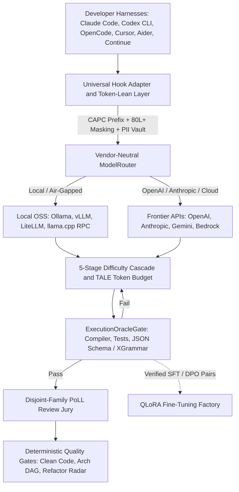

# Kaizen Engineering Kit v4.0 (`kaizen-engineering-kit`)

**Plug-and-Play Deterministic AI Engineering Toolkit for Claude Code, OpenAI Codex CLI, ChatGPT/OpenAI, OpenCode, Cursor, Aider, Continue, and Local OSS (`Ollama` / `vLLM` / `LiteLLM` / `llama.cpp`) — Model- and Vendor-Agnostic.**

[](LICENSE)
[](pyproject.toml)
[](install.py)
[](docs/HARNESS_GUIDE.md)

`kaizen-engineering-kit` transforms stochastic AI coding assistants into deterministic, execution-verified engineering systems. It wraps any local open-weight model or commercial API with **zero-LLM AST/architecture gates**, **65%–88% token-reduction hooks**, **5-stage execution-verified model cascades**, **disjoint-family Panel-of-LLM (PoLL) review juries**, and an **Execution-Oracle Best-of-N QLoRA fine-tuning factory**.

---

## Architecture & Plug-and-Play Flow



---

## 30-Second Quick Start

### 1. Install (Zero Mandatory Runtime Dependencies for Core CLI & Gates)

```bash
# Editable install from repository root
pip install -e .

# Auto-detect and configure installed harnesses non-destructively (preserves existing auth/keys)
python3 install.py --harness auto

# Verify health and run deterministic offline self-tests
kaizen-kit doctor --self-test
```

### 2. Choose Your Runtime (Any Model or Provider)

#### (A) Pure Local OSS (`Ollama` / `vLLM` / `LiteLLM` — 100% Offline, $0 API Cost)
```bash
export KAIZEN_PROVIDER="ollama"
export KAIZEN_OFFLINE="1"
export OLLAMA_HOST="http://127.0.0.1:11434"
export KAIZEN_DEFAULT_MODEL="qwen3-coder:30b-a3b"

ollama pull qwen3-coder:30b-a3b
kaizen-kit check .
```

#### (B) OpenAI / Codex CLI (`gpt-4.1` / `gpt-4o` / `o3`)
```bash
export KAIZEN_PROVIDER="openai"
export OPENAI_API_KEY="sk-proj-..."
export KAIZEN_DEFAULT_MODEL="gpt-4.1"

python3 install.py --harness codex
kaizen-kit check .
```

#### (C) Anthropic / Claude Code (`claude-sonnet` / `claude-opus`)
```bash
export KAIZEN_PROVIDER="anthropic"
export ANTHROPIC_API_KEY="sk-ant-..."
export KAIZEN_DEFAULT_MODEL="claude-sonnet-4-20250514"

python3 install.py --target claude
kaizen-kit check .
```

#### (D) Hybrid Multi-Provider Pool (Local OSS + OpenAI / Anthropic / Optional Gemini)
```bash
export KAIZEN_PROVIDER="auto"
# Automatically routes confidential code to local OSS and public/sanitized tasks across configured providers
kaizen-kit carbon status
```

---

## Core Capabilities Matrix

### 1. Five Open-Source Engineering Levers

| Lever | Implementation Module | What It Delivers |
| :--- | :--- | :--- |
| **1. Constrained Decoding (`XGrammar` / `GBNF`)** | `kaizen_kit.localmodels` / `kaizen_kit.adk_agents` | Enforces 100% schema-valid JSON, tool calls, and diff grammars at token sampling time on `vLLM` (`xgrammar`) and `llama.cpp` (`GBNF`), eliminating malformed JSON retries. |
| **2. Hybrid Code RAG + Document OCR** | `kaizen_kit.gates.symbol_rag_indexer` / `crates/radar-core` | Combines native Rust AST graph indexing, SQLite FTS5 / BM25 lexical search, and LanceDB vector embeddings with Reciprocal Rank Fusion (RRF) and layout-aware OCR ingestion. |
| **3. Distributed Spot & `llama.cpp` RPC Orchestration** | `kaizen_kit.gpu_burst_orchestrator` / `kaizen_kit.mini_pool` | Tensor-splits 32B–70B+ models across heterogeneous `llama.cpp` RPC nodes or scales ephemeral Spot GPU pools (`g4dn` / `g6e`) with automatic scale-to-zero (`$0` idle cost). |
| **4. Best-of-N Execution-Oracle + QLoRA Factory** | `kaizen_kit.qlora_pipeline` | Samples `N` candidates, filters via compiler/test/AST `ExecutionOracleGate`, mines verified SFT winners (`y_w`) and hard-negative DPO pairs (`y_l`), and exports `vLLM` + `GGUF` LoRA adapters. |
| **5. Streaming Guardrails & Voice-to-Action** | `kaizen_kit.guardrails` | Real-time streaming secret/PII interception (`DeterministicVault`), loop abort guards, and Hybrid-VAD voice-to-action command dispatch with local `whisper-large-v3-turbo` fallback. |

### 2. Six Token-Reduction Techniques (65%–88% Savings)

Detailed in [docs/TOKEN_REDUCTION.md](docs/TOKEN_REDUCTION.md):
1. **CAPC Prefix Ordering & Dynamic-Only Compression**: Locks immutable system/schema prefixes at byte `0` for `75%–90%` KV cache hit rates.
2. **Observation Masking (`>80L`) & Lossless Test Distillation**: Compresses verbose build/test logs into exact failing assertions (`70%–92%` stdout reduction).
3. **TALE Dynamic Token-Budget Policy**: Caps reasoning and output tokens proportionally to task difficulty (`45%–68%` output token savings).
4. **Zero-LLM AST Skeleton Extractor (`~80%`)**: Extracts structural signatures without function bodies via `kaizen-kit skeleton`.
5. **KV-Cache `Q8_0` Quantization & Prefix Caching**: Halves KV VRAM (`-ctk q8_0 -ctv q8_0`) and enables `--enable-prefix-caching` + GPU `EAGLE-3` speculative decoding.
6. **Voice Hybrid VAD & Sliding-Window Compression**: Saves `~25 tok/sec` (`1,500 tok/min`) during silence and bounds long sessions to `<24k` tokens.

### 3. Clean Architecture & Senior Review Gates (Zero LLM Tokens)

- **Clean Code Gate (`check_clean_code.py`)**: Enforces cognitive complexity `<= 10`, guard clauses over nested pyramids, and deep modules.
- **Abstract AST & Provenance Gate (`verify_provenance.py` & `arch_audit.py`)**: Enforces bounded-context isolation (`INV-ISOLATION`), Law of Demeter provenance (`INV-PROVENANCE`), zero synthetic production literals (`INV-NO-SYNTHETIC-LITERAL`), and immutable compile-time schemas (`INV-COMPILE-TIME-SCHEMA`).
- **Senior Review Lint (`senior_review_lint.py`)**: Deterministically catches silent exception swallowing, unbounded timeouts, N+1 loops, and concurrency hazards before code review.
- **L1–L4 Parity Regression Gate (`parity_gate.py`)**: Verifies schema parity, row counts, non-null field coverage, and latency invariants across service migrations.

### 4. Seven Canonical Engineering Codices (`assets/references/codices/`)

Distilled, token-dense architectural references accessible offline via `kaizen-kit docs codex <name>`:
1. `01-clean-code-complete-codex.md` — Functions, naming, cognitive complexity, and cohesion invariants.
2. `02-clean-architecture-complete-codex.md` — Dependency inversion, hexagonal boundaries, and domain isolation.
3. `03-refactoring-guru-66-and-22-smells.md` — Catalog of 22 code smells mapped to 66 deterministic refactorings.
4. `04-gof-22-patterns-and-anti-traps.md` — Gang of Four structural/behavioral/creational patterns and anti-pattern traps.
5. `05-rust-aposd-ddd-official-codex.md` — Rust API Guidelines, typestate invariants, zero-primitive newtypes, and APOSD deep modules.
6. `06-effective-java21-spring-loom-codex.md` — Effective Java 21, Project Loom virtual threads, ArchUnit, and RFC 9457 ProblemDetail.
7. `07-aws-ddia-toc-observability-codex.md` — DDIA distributed systems invariants, OpenTelemetry FinOps, and Theory of Constraints.

---

## CLI Reference (`kaizen-kit`)

| Command | Description | Example |
| :--- | :--- | :--- |
| `kaizen-kit install` | Non-destructively install hooks, skills, agents, and MCP configs for target harnesses | `kaizen-kit install --target all` |
| `kaizen-kit doctor` | Inspect kit health, detected model providers, codices, and run deterministic self-tests | `kaizen-kit doctor --self-test` |
| `kaizen-kit check` | Run pre-flight Clean Code, provenance, secret scan, and senior-review gates | `kaizen-kit check --pre-flight .` |
| `kaizen-kit arch-audit` | Audit Clean Architecture layer boundaries and dependency direction | `kaizen-kit arch-audit src/` |
| `kaizen-kit skeleton` | Extract zero-LLM AST structural skeleton (`~80%` token reduction vs. raw file read) | `kaizen-kit skeleton src/kaizen_kit/model_router.py` |
| `kaizen-kit parity` | Run L1–L4 schema, payload, and latency parity verification between baseline and target | `kaizen-kit parity --self-test` |
| `kaizen-kit carbon` / `cascade` | Run 5-stage model cascade routing, TALE token budgeting, PoLL jury, or LiteLLM config export | `kaizen-kit carbon route --task "Fix race condition"` |
| `kaizen-kit qlora` / `best-of-n` | Execute Best-of-N execution-oracle SFT/DPO dataset synthesis and emit QLoRA training scripts | `kaizen-kit qlora self-test` |
| `kaizen-kit night-shift` | Run autonomous overnight batch refactoring, test hardening, and morning diff report | `kaizen-kit night-shift --morning` |
| `kaizen-kit gpu-burst` | Plan and inspect scale-to-zero Spot GPU tiers, KV-cache `Q8_0`/`FP8` configs, and RPC fleets | `kaizen-kit gpu-burst tiers` |
| `kaizen-kit mcp-render` / `mcp` | Launch or render the FastMCP gateway configuration for any MCP-compatible IDE/CLI | `kaizen-kit mcp-render` |

---

## Documentation Suite

- **[Architecture & Execution Pipelines](docs/ARCHITECTURE.md)** — Deep dive into the 5-Stage Verification Cascade, Disjoint-Family PoLL Jury, Execution-Oracle Best-of-N QLoRA Factory, and Distributed `llama.cpp` RPC + `vLLM` Serving.
- **[Universal Harness Integration Guide](docs/HARNESS_GUIDE.md)** — Step-by-step setup and copy-paste configurations for **Claude Code**, **OpenAI Codex CLI**, **ChatGPT / OpenAI API**, **OpenCode**, **Cursor**, **Aider**, **Continue**, and **100% Offline Ollama / vLLM / LiteLLM**.
- **[Token Reduction Architecture](docs/TOKEN_REDUCTION.md)** — Technical specification and savings benchmarks for the 6 token-saving mechanisms (CAPC Prefix Ordering, `>80L` Observation Masking, TALE Dynamic Budgets, AST Skeletons, KV-Cache `Q8_0` & Prefix Caching, and Voice Hybrid VAD).

---

## License

Released under the [MIT License](LICENSE).
