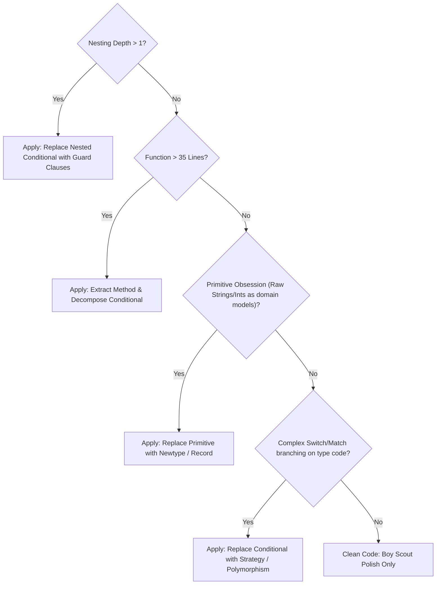

# Refactoring.Guru & Clean Code Practitioner (`refactor-guru`)

This skill provides deterministic recipes to diagnose code smells, refactor legacy code, and apply modern design patterns across Rust and Java codebases.

---

## 1. Quick Diagnosis Decision Tree

When examining a function, struct, or module, check these 4 questions:



---

## 2. The Core Refactoring Recipes

### Recipe A: Flattening Nested Pyramids (Guard Clauses)
* **Smell**: Deeply nested `if` / `match` blocks ($O(N^2)$ cognitive load).
* **Fix**:
  1. Identify all preconditions and validation checks.
  2. Invert the condition and exit immediately (`return`, `continue`, `break`, or `?`).
  3. Keep the "happy path" un-indented at the root level of the function.

```rust
// ❌ BEFORE (Nested Pyramid)
pub fn process_event(event: Option<Event>, status: Status) -> Result<(), Error> {
    if let Some(ev) = event {
        if status == Status::Active {
            if ev.is_valid() {
                save_to_database(ev)?;
            }
        }
    }
    Ok(())
}

// ✅ AFTER (Guard Clauses)
pub fn process_event(event: Option<Event>, status: Status) -> Result<(), Error> {
    let Some(event) = event else { return Ok(()); };
    if status != Status::Active || !event.is_valid() {
        return Ok(());
    }

    save_to_database(event)?;
    Ok(())
}
```

---

### Recipe B: Eliminating Primitive Obsession
* **Smell**: Carrying raw strings for MAC addresses, SSIDs, timestamps, or state codes.
* **Fix**:
  1. Wrap the primitive in a dedicated type (Rust `struct MacAddress([u8; 6]);` or Java `record MacAddress(String value)`).
  2. Implement validation and parsing once inside `TryFrom` / constructor.
  3. All downstream functions accept the typed wrapper, eliminating redundant validation across callers.

---

### Recipe C: Replacing Conditional with Strategy
* **Smell**: Massive `match` or `switch` statements calculating different scores, metrics, or formats based on domain type codes.
* **Fix**:
  1. Define a focused Trait / Interface (e.g. `ScoreCalculator`).
  2. Create specialized implementations for each variant.
  3. Dispatch dynamically or statically via `impl ScoreCalculator`.

---

## 3. Reference Guides
* [Code Smells Catalog](./references/code-smells.md): Complete list of 22 smells and their symptoms.
* [Uncle Bob's Clean Code Heuristics](./references/clean-code.md): Functions, naming, error handling, and SOLID invariants.
* [Design Patterns & Rust/Java Mapping](./references/patterns.md): 22 GoF patterns mapped to idiomatic Rust & Java 21.

