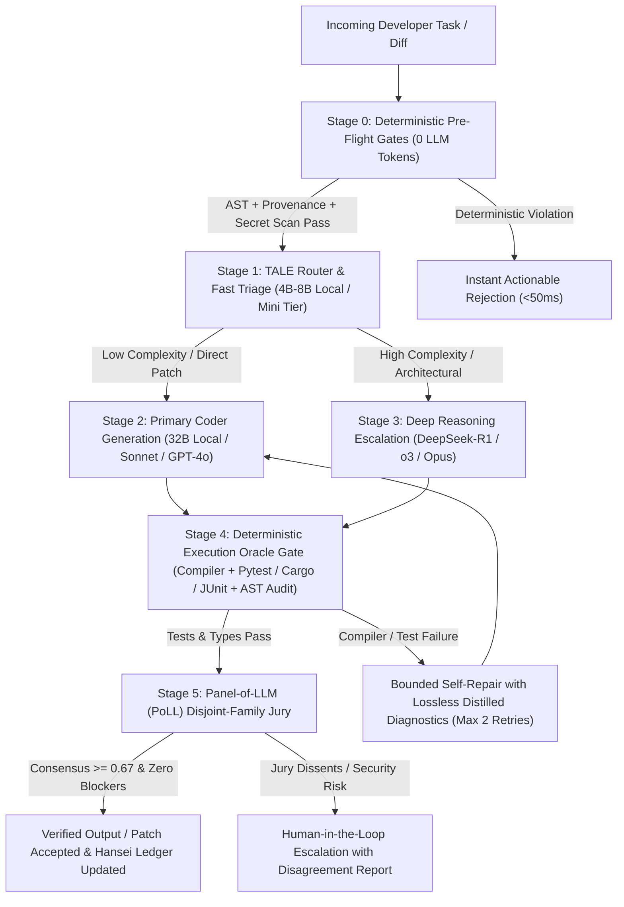
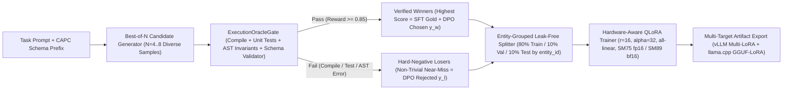
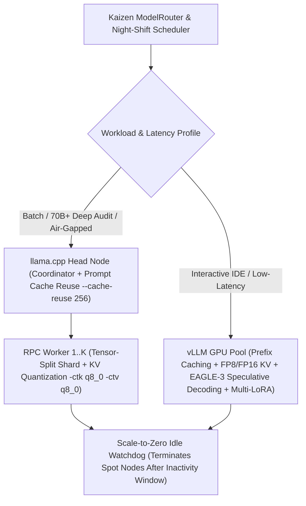

# Architecture & Execution Pipelines (`kaizen-engineering-kit` v4.0)

`kaizen-engineering-kit` is an open, vendor-neutral AI engineering system designed around a single principle: **every stochastic LLM action is bounded by deterministic compilation, AST provenance, and execution gates**.

Whether your team runs **100% offline local open-weight models** (`Ollama`, `vLLM`, `llama.cpp`, `LiteLLM`), **OpenAI / Codex CLI**, **Anthropic / Claude Code**, **OpenCode**, **Cursor**, **Aider**, or **hybrid cloud pools**, the same deterministic verification architecture applies.

---

## 1. Five-Stage Cascade + Execution Gate + PoLL Jury

Instead of routing every developer prompt to an expensive frontier model—or blindly trusting a single model's self-review—`kaizen-engineering-kit` uses a **5-Stage Verification Cascade** (`carbon_orchestrator.py` & `model_router.py`).

### Why the 5-Stage Cascade Outperforms Single-Model Agents
1. **Stage 0 — Zero-Token Deterministic Gates (`kaizen_kit.gates`)**:
   - Catches clean-code violations (cognitive complexity `>10`, nested pyramids), architectural boundary leaks, synthetic mock literals, and secret/PII exposures in `<50ms` before spending a single LLM token.
2. **Stage 1 — TALE Budget & Residency Router (`kaizen_kit.model_router`)**:
   - Inspects data classification (`confidential_code`, `internal_telemetry`, `public_sanitized`) and available providers (`Ollama`, `vLLM`, `LiteLLM`, `OpenAI`, `Anthropic`, `Gemini`).
   - Enforces air-gapped local routing when `KAIZEN_OFFLINE=1` or when data residency forbids external cloud egress.
3. **Stage 2 & Stage 3 — Difficulty-Proportional Generation**:
   - Routine patches execute on fast, cost-effective models (`qwen2.5-coder:32b`, `gpt-4o`, `claude-sonnet`), escalating to heavy reasoning models only when structural complexity or a failed execution gate demands it.
4. **Stage 4 — Deterministic Execution Oracle Gate (`ExecutionOracleGate`)**:
   - No code change proceeds to review unless it compiles cleanly and passes the target test suite and AST parity checks.
5. **Stage 5 — Panel-of-LLM (PoLL) Disjoint-Family Jury**:
   - Eliminates single-model self-preference bias by convening 3 lightweight judges from **distinct model families** (e.g., Judge A: `Qwen/DeepSeek`, Judge B: `Claude/Haiku`, Judge C: `GPT-4o-mini/Llama-3.3`) scoring correctness, architectural invariants, and security independently.

---

## 2. QLoRA Best-of-N Execution-Verified SFT & DPO Factory

Fine-tuning models on unverified synthetic outputs causes model collapse. `kaizen_kit.qlora_pipeline` implements an **Execution-Oracle Best-of-N Synthesis Pipeline** that turns real engineering tasks into verified Supervised Fine-Tuning (SFT) and Direct Preference Optimization (DPO) datasets.

### Key Engineering Invariants in `qlora_pipeline.py`
- **CAPC Schema Prompt Compression (`SchemaPromptCacheManager`)**: Normalizes JSON, SQL, Rust, and Java schemas into deterministic, whitespace-compacted prefixes with SHA-256 cache digests (`schema_cache_id`), ensuring high prefix-cache hit rates during `N`-sample generation.
- **Hard-Negative DPO Pair Mining (`ExecutionOracleGate`)**:
  - **Chosen (`y_w`)**: Highest-scoring candidate that passes all deterministic compilation, test, and schema gates (`reward >= 0.85`).
  - **Rejected (`y_l`)**: Plausible hard-negative candidate that fails a specific deterministic check (e.g., boundary violation or off-by-one test failure), filtering out empty or degenerate completions so DPO learns true engineering boundaries.
- **Zero-Leakage Entity-Grouped Splitting**: Groups samples by `entity_id` (module, repository, or ticket family) prior to train/validation/test partitioning so no entity spans multiple splits.
- **Hardware-Aware QLoRA Configuration**:
  - Automatically adapts precision to the target GPU architecture: `fp16` on Turing `SM75` (`g4dn` / `T4`) vs. `bf16` + FlashAttention-2 on Ada/Hopper `SM89+` (`g6e` / `L40S` / `A100`).
  - Exports adapters simultaneously for **vLLM dynamic multi-LoRA serving** and **`llama.cpp` GGUF-LoRA (`--lora`)** local CPU/Apple Silicon inference.

---

## 3. Distributed Inference & KV-Cache Optimization (`llama.cpp` RPC + `vLLM`)

`kaizen_kit.gpu_burst_orchestrator` and `kaizen_kit.mini_pool` manage elastic local and cloud Spot inference pools with **$0 idle GPU cost**.

### Distributed Runtime Capabilities
1. **`llama.cpp` Distributed RPC Tensor Splitting**:
   - Aggregates VRAM/RAM across heterogeneous machines or low-cost Spot instances (`rpc-server`) to run 32B–70B+ open-weight models without expensive single-node multi-GPU servers.
   - Applies `-ctk q8_0 -ctv q8_0` KV-cache quantization and `--cache-reuse 256` to halve memory bandwidth pressure across the network.
2. **`vLLM` High-Throughput Multi-LoRA Serving**:
   - Serves a single base open-weight model (`Qwen2.5-Coder`, `Llama-3.3`, `DeepSeek`) alongside multiple specialized domain LoRA adapters in the same VRAM footprint.
   - Combines `--enable-prefix-caching` with GPU **EAGLE-3 speculative decoding** for maximum tokens/second on interactive coding tasks.
3. **Polyglot Refactor Radar (`crates/radar-core` + `kaizen_kit.radar`)**:
   - Pairs a native Rust AST/graph hotspot engine (`radar-core`) with DuckDB analytical storage and LanceDB hybrid vector+BM25 Reciprocal Rank Fusion (RRF) search for sub-50ms repository blast-radius analysis.
