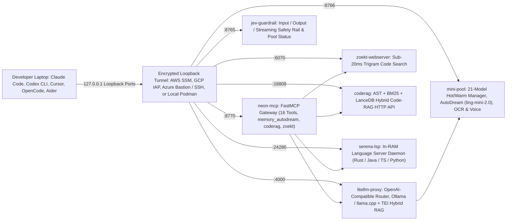

# Thin-Client + 128 GiB ARM64 Cloud-Brain Architecture & Multi-Cloud IaC

`kaizen-engineering-kit` supports a **Thin-Client + 128 GiB ARM64 Cloud-Brain** deployment topology (`infra/cloud_brain/`). Instead of pinning heavy language servers, vector databases, trigram indexes, and multi-model LLM runtimes directly on a developer laptop—or paying for an always-on multi-GPU cluster—the entire 25-model / 7-service intelligence plane runs inside a rootless Podman stack on a single **128 GiB ARM64 CPU host** (or local workstation) exposed strictly over **7 encrypted `127.0.0.1` loopback tunnels**.

---

## 1. Why Thin-Client + 128 GiB ARM64 Cloud-Brain?

### Architectural & FinOps Rationale

1. **Zero Laptop Thermal & RAM Tax (`< 250 MB` Local Footprint)**:
   - Modern multi-repository workspaces routinely consume `16–40 GiB` of laptop RAM across Java/Rust/TypeScript language servers (`jdtls`, `rust-analyzer`, `tsserver`), local vector indexes, and local GGUF models.
   - By offloading **Serena RAM LSP (`:24280`)**, **Zoekt Trigram Search (`:6070`)**, **Hybrid Code-RAG (`:18808`)**, and **Sparse-MoE LLM Inference (`:4000`)** to the Cloud-Brain, the developer laptop runs only the editor/CLI harness and 7 lightweight loopback forwarders.
2. **Sparse-MoE on High-Bandwidth ARM64 CPU (`58 GiB` Resident Core < `72 GiB` Safe Ceiling)**:
   - Sparse Mixture-of-Experts models such as `qwen3-coder-30b-a3b` and `qwen3.5-35b-a3b` activate only **~3B parameters per token** despite holding `30B–35B` total parameters in memory.
   - An ARM64 CPU instance with `128 GiB` DDR5 memory (e.g., AWS Graviton3 `m7g.8xlarge` / `c7g.8xlarge`, GCP Axion `c4a-standard-32`, Azure Ampere Altra `Standard_D32pls_v5`) sustains high interactive token generation throughput for 3B-active MoE models and sub-50ms micro-classifiers without requiring an always-on GPU.
   - The resident core footprint (`~58 GiB` across active `Q4_K_M` MoE weights, `Q8_0` KV caches, TEI embeddings, and in-RAM LSP indexes) stays comfortably below the **`72 GiB` safe resident ceiling**, leaving `> 56 GiB` for OS page cache, ZRAM headroom, and on-demand LRU specialist swaps (`128 GiB` total RAM).
3. **Eliminating Always-On GPU Burn (`$0` Idle GPU Cost + Idle Auto-Stop)**:
   - Dedicated GPUs are reserved strictly for ephemeral scale-to-zero Spot bursts (`kaizen-kit gpu-burst` for `235B` audits or QLoRA training).
   - On the CPU Cloud-Brain host, an automated systemd idle watchdog (`kaizen-idle-guard.timer`) monitors active tunnel traffic and CPU load, automatically stopping the instance after configurable inactivity so nights and weekends incur **zero compute cost**.

---

## 2. End-to-End Topology Diagram



---

## 3. 7-Port Loopback Reference Table

All services bind exclusively to `127.0.0.1` (`KAIZEN_BIND_ADDR=127.0.0.1`) on the Cloud-Brain host and map 1:1 to `127.0.0.1` on the developer laptop:

| Loopback Port | Container / Service | Protocol | Primary Role & Capabilities | Health Check Endpoint |
| :--- | :--- | :--- | :--- | :--- |
| **`127.0.0.1:4000`** | `litellm-proxy` (+ internal `ollama` & `tei`) | HTTP (OpenAI v1) | Unified OpenAI-compatible router (`/v1/chat/completions`, `/v1/embeddings`) fronting Sparse-MoE coders (`qwen3-coder-30b-a3b`, `qwen3.5-35b-a3b`) and TEI hybrid embed/rerank (`bge-m3`, `qwen3-reranker-0.6b`) | `http://127.0.0.1:4000/health/liveliness` |
| **`127.0.0.1:8765`** | `jev-guardrail` | HTTP JSON | Sub-50ms input/output/streaming safety guardrail (`qwen3-guard-0.6b`, `qwen3-guard-stream-0.6b`), secret/PII redaction check, and live pool health telemetry | `http://127.0.0.1:8765/health` |
| **`127.0.0.1:8766`** | `mini-pool` | HTTP JSON | 21-model Hot/Warm LRU lifecycle manager (`58 GiB` core / `72 GiB` ceiling), **AutoDream** (`ling-mini-2.0`) sleep-cycle memory consolidation, document OCR (`docling-v2`), and Hybrid-VAD voice dispatch | `http://127.0.0.1:8766/health` |
| **`127.0.0.1:8770`** | `neon-mcp` | HTTP / SSE (FastMCP) | Unified FastMCP tool server exposing 16 deterministic tools (`neon_*`, `memory_autodream`, `coderag_*`, `zoekt_*`) to Claude Code, Codex CLI, Cursor, and OpenCode | `http://127.0.0.1:8770/health` |
| **`127.0.0.1:6070`** | `zoekt-webserver` | HTTP JSON / Web | Sub-20ms CTags-enhanced trigram regex and symbol search across all indexed repositories | `http://127.0.0.1:6070/` |
| **`127.0.0.1:18808`** | `coderag` | HTTP JSON | Hybrid Code-RAG engine combining AST structural chunking, BM25 lexical matching, dense vector search, and Reciprocal Rank Fusion (RRF) | `http://127.0.0.1:18808/health` |
| **`127.0.0.1:24280`** | `serena-lsp` | HTTP / MCP | Persistent in-RAM language server daemon (`rust-analyzer`, `jdtls`, `tsserver`, `pyright`) for instant symbol lookup and cross-reference queries | `http://127.0.0.1:24280/health` |

---

## 4. Resident Memory Budget (`128 GiB` ARM64 Host)

| Tier | Allocation | Models & Daemons | Operational Invariant |
| :--- | :--- | :--- | :--- |
| **Resident Hot Core** | **`~58 GiB`** | `qwen3-coder-30b-a3b` (`Q4_K_M`), `qwen3.5-4b`, `ling-mini-2.0` (`AutoDream`), `qwen3-guard-0.6b` + `stream-0.6b`, `bge-m3` + `qwen3-reranker-0.6b` (TEI), `zoekt`, `coderag`, `serena-lsp` | Permanently pinned in RAM for zero cold-start latency. |
| **Safe Resident Ceiling** | **`72 GiB` Max** | Enforced by `mini-pool` (`:8766`) memory governor (`KAIZEN_SAFE_RAM_CEILING_GB=72`) | Any on-demand warm specialist (`qwen3.5-35b-a3b`, `gemma-4-26b-a4b`, `olmocr-2-7b`, `whisper-large-v3-turbo`) triggers LRU eviction before exceeding `72 GiB`. |
| **OS Cache & Headroom** | **`56 GiB` Free** | Linux page cache for mmap'd GGUF weights, ZRAM swap buffer, and workspace builds | Prevents OOM thrashing and enables sub-second warm model page-ins. |

---

## 5. Step-by-Step Deployment Guide

All infrastructure templates live under [`infra/cloud_brain/`](../infra/cloud_brain/):
- [`infra/cloud_brain/docker-compose.yml`](../infra/cloud_brain/docker-compose.yml) — Rootless Podman / Docker Compose 7-service stack
- [`infra/cloud_brain/bootstrap-cloud-brain.sh`](../infra/cloud_brain/bootstrap-cloud-brain.sh) — Ubuntu 24.04 ARM64/x86_64 host bootstrap & systemd user linger installer
- [`infra/cloud_brain/aws-cloudformation.yaml`](../infra/cloud_brain/aws-cloudformation.yaml) — AWS Graviton3 CloudFormation stack (SSM-only, zero public ingress)
- [`infra/cloud_brain/gcp-cloud-brain.tf`](../infra/cloud_brain/gcp-cloud-brain.tf) — GCP Axion / Tau ARM64 Terraform stack (IAP-only firewall)
- [`infra/cloud_brain/azure-bicep.bicep`](../infra/cloud_brain/azure-bicep.bicep) — Azure Ampere Altra ARM64 Bicep template (zero public SSH)

---

### Option A: Local / Bare-Metal Rootless Podman (or Docker Compose)

Run the entire Cloud-Brain stack locally on a high-RAM workstation or on your own bare-metal Ubuntu 24.04 server:

```bash
# 1. (Optional) Bootstrap an Ubuntu 24.04 bare-metal host with rootless Podman & sysctl tuning
sudo bash infra/cloud_brain/bootstrap-cloud-brain.sh

# 2. Configure environment variables (defaults bind strictly to 127.0.0.1)
export KAIZEN_BIND_ADDR="127.0.0.1"
export KAIZEN_WORKSPACE="${PWD}"
export KAIZEN_MODELS_DIR="${HOME}/.cache/kaizen-models"

# 3. Launch with Rootless Podman Compose
podman compose -f infra/cloud_brain/docker-compose.yml up -d

# (Or with Docker Compose v2)
docker compose -f infra/cloud_brain/docker-compose.yml up -d

# 4. Verify all 7 loopback endpoints
kaizen-kit doctor
```

---

### Option B: AWS CloudFormation (`m7g.8xlarge` / `c7g.8xlarge` + AWS SSM Loopback Tunnels)

Deploys an ARM64 Graviton3 instance (`128 GiB` RAM, encrypted `250 GiB` GP3 volume) inside a VPC with **zero inbound SecurityGroup rules** and `AmazonSSMManagedInstanceCore` IAM permissions.

#### 1. Deploy the CloudFormation Stack

```bash
aws cloudformation deploy \
  --stack-name kaizen-cloud-brain \
  --template-file infra/cloud_brain/aws-cloudformation.yaml \
  --capabilities CAPABILITY_IAM \
  --parameter-overrides \
    InstanceType=m7g.8xlarge \
    VpcId=vpc-0123456789abcdef0 \
    SubnetId=subnet-0123456789abcdef0 \
    DiskSizeGb=250 \
    EnableIdleGuard=true
```

#### 2. Open the 7-Port Loopback Tunnel via AWS SSM Session Manager

No SSH keys, bastion hosts, or public IPs are required. Run the loop below on your laptop (macOS / Linux / WSL / Git Bash) or via PowerShell to forward all 7 ports over IAM-authenticated SSM:

```bash
export INSTANCE_ID="i-0123456789abcdef0"
export AWS_REGION="eu-west-1"

for PORT in 4000 8765 8766 8770 6070 18808 24280; do
  aws ssm start-session \
    --target "${INSTANCE_ID}" \
    --region "${AWS_REGION}" \
    --document-name AWS-StartPortForwardingSession \
    --parameters "{\"portNumber\":[\"${PORT}\"],\"localPortNumber\":[\"${PORT}\"]}" &
done
```

---

### Option C: GCP Terraform (`c4a-standard-32` / `t2a-standard-32` + Cloud IAP Tunnels)

Deploys an ARM64 GCP Compute Engine instance (`128 GiB` RAM, `250 GiB` `pd-ssd`) with a firewall rule allowing ingress **exclusively from Google Cloud Identity-Aware Proxy (`35.235.240.0/20`)** and zero `0.0.0.0/0` exposure.

#### 1. Provision with Terraform

```bash
cd infra/cloud_brain
terraform init
terraform apply \
  -var="project_id=my-gcp-project" \
  -var="region=europe-west1" \
  -var="zone=europe-west1-b" \
  -var="machine_type=c4a-standard-32"
```

#### 2. Open the 7-Port Loopback Tunnel via `gcloud compute start-iap-tunnel`

```bash
export GCP_PROJECT="my-gcp-project"
export GCP_ZONE="europe-west1-b"
export GCP_INSTANCE="kaizen-cloud-brain"

for PORT in 4000 8765 8766 8770 6070 18808 24280; do
  gcloud compute start-iap-tunnel "${GCP_INSTANCE}" "${PORT}" \
    --local-host-port="127.0.0.1:${PORT}" \
    --zone="${GCP_ZONE}" \
    --project="${GCP_PROJECT}" &
done
```

---

### Option D: Azure Bicep (`Standard_D32pls_v5` / `Standard_E16pls_v5` + Bastion / SSH `-L`)

Deploys an ARM64 Ampere Altra Azure VM (`128 GiB` RAM, `250 GiB` Premium SSD v2, System-Assigned Managed Identity) inside a locked-down Network Security Group with **no public SSH rule**.

#### 1. Deploy the Bicep Template

```bash
az group create --name rg-kaizen-cloud-brain --location westeurope

az deployment group create \
  --resource-group rg-kaizen-cloud-brain \
  --template-file infra/cloud_brain/azure-bicep.bicep \
  --parameters \
    vmName=kaizen-cloud-brain \
    vmSize=Standard_D32pls_v5 \
    osDiskSizeGb=250 \
    adminUsername=kaizen \
    sshPublicKey="$(cat ~/.ssh/id_ed25519.pub)"
```

#### 2. Open the 7-Port Loopback Tunnel via Azure Bastion / SSH `-L`

Using an Azure Bastion native tunnel (`az network bastion ssh`) or private VNet/VPN route, forward all 7 loopback ports in a single multiplexed connection:

```bash
ssh -N \
  -L 127.0.0.1:4000:127.0.0.1:4000 \
  -L 127.0.0.1:8765:127.0.0.1:8765 \
  -L 127.0.0.1:8766:127.0.0.1:8766 \
  -L 127.0.0.1:8770:127.0.0.1:8770 \
  -L 127.0.0.1:6070:127.0.0.1:6070 \
  -L 127.0.0.1:18808:127.0.0.1:18808 \
  -L 127.0.0.1:24280:127.0.0.1:24280 \
  kaizen@10.240.1.10
```

---

## 6. Connecting Your Local Harness to the Cloud-Brain

Once the 7 loopback tunnels are active (or local Podman is running), point any supported harness (`Claude Code`, `Codex CLI`, `OpenCode`, `Cursor`, `Aider`, `Continue`) at `127.0.0.1`:

```bash
export KAIZEN_PROVIDER="litellm"
export OPENAI_BASE_URL="http://127.0.0.1:4000/v1"
export LITELLM_BASE_URL="http://127.0.0.1:4000/v1"
export KAIZEN_DEFAULT_MODEL="qwen3-coder-30b-a3b"
export KAIZEN_MCP_URL="http://127.0.0.1:8770/sse"
export KAIZEN_GUARDRAIL_URL="http://127.0.0.1:8765"
export KAIZEN_MINI_POOL_URL="http://127.0.0.1:8766"

# Install MCP & hook bindings into your active IDE/CLI harnesses
python3 install.py --harness auto
kaizen-kit doctor --self-test
```

---

## 7. Security & Zero-Public-Port Invariants

Every deployment option in `infra/cloud_brain/` enforces five defense-in-depth invariants:

1. **Loopback-Only Socket Binding (`127.0.0.1`)**:
   - Every container port mapping in `infra/cloud_brain/docker-compose.yml` uses `${KAIZEN_BIND_ADDR:-127.0.0.1}:<port>:<port>`. Even if a host firewall were misconfigured, the container sockets do not listen on `0.0.0.0`.
2. **Zero `0.0.0.0/0` Inbound Network Rules**:
   - **AWS (`aws-cloudformation.yaml`)**: SecurityGroup `SecurityGroupIngress` is empty (`[]`); access uses outbound-initiated AWS SSM Session Manager channels.
   - **GCP (`gcp-cloud-brain.tf`)**: Firewall ingress is restricted strictly to Google Cloud IAP (`35.235.240.0/20`) on TCP `22`.
   - **Azure (`azure-bicep.bicep`)**: Network Security Group denies public internet ingress and permits SSH/tunneling solely from internal VNet / Azure Bastion subnets.
3. **Rootless Podman Isolation**:
   - Containers execute under an unprivileged user namespace (`loginctl enable-linger`) with `no-new-privileges:true`, preventing container-to-host root escalation.
4. **Encrypted At-Rest Storage & Ephemeral Vaulting**:
   - Cloud volumes use encrypted block storage (`AWS KMS GP3`, `GCP pd-ssd`, `Azure Premium SSD`), and all outbound prompts pass through `DeterministicVault` + `jev-guardrail` (`:8765`) before leaving the developer workstation.
5. **Automated Idle Shutdown (`kaizen-idle-guard`)**:
   - When active tunnel connections drop to zero for the configured window, the host cleanly checkpoints SQLite/LanceDB state and powers down to eliminate unattended attack surface and cloud spend.
