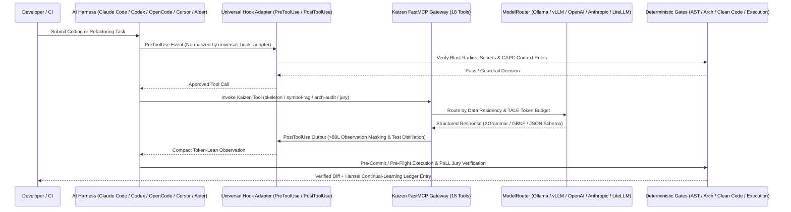

# Universal Harness Integration Guide (`kaizen-engineering-kit` v4.0)

`kaizen-engineering-kit` is completely **vendor-neutral and harness-agnostic**. It plugs non-destructively into any major AI coding agent, CLI harness, IDE assistant, or **100% offline local open-weight runtime** without overwriting existing user API keys, OAuth tokens, or custom MCP servers.

---

## Universal Hook & MCP Execution Sequence



---

## Automatic Multi-Harness Bootstrap

Install the package and let the installer auto-detect and configure your installed harnesses non-destructively:

```bash
pip install -e .

# Auto-detect and configure installed harnesses (preserves existing auth & MCP entries)
python3 install.py --harness auto
# or target all supported configurations explicitly:
kaizen-kit install --target all
```

To inspect detected providers and verify your installation at any time:

```bash
kaizen-kit doctor --self-test
```

---

## 1. 100% Offline Local OSS (`Ollama` / `vLLM` / `LiteLLM` / `llama.cpp`)

Run `kaizen-engineering-kit` with **zero cloud API keys** and **zero external network egress** using local open-weight models.

### Environment Variables
```bash
export KAIZEN_PROVIDER="ollama"
export KAIZEN_OFFLINE="1"
export OLLAMA_HOST="http://127.0.0.1:11434"
export KAIZEN_DEFAULT_MODEL="qwen2.5-coder:32b"
export KAIZEN_FAST_MODEL="qwen2.5-coder:7b"
```

### Pull Recommended Open-Weight Models (Ollama)
```bash
ollama pull qwen2.5-coder:7b
ollama pull qwen2.5-coder:32b
ollama pull deepseek-r1:32b
```

### Alternative: Local `vLLM` or `LiteLLM` Proxy
```bash
# Direct vLLM OpenAI-compatible server with Prefix Caching & FP8/FP16 KV cache
export KAIZEN_PROVIDER="vllm"
export VLLM_BASE_URL="http://127.0.0.1:8000/v1"
export KAIZEN_DEFAULT_MODEL="Qwen/Qwen2.5-Coder-32B-Instruct"

# Or LiteLLM unified local gateway
export KAIZEN_PROVIDER="litellm"
export LITELLM_BASE_URL="http://127.0.0.1:4000/v1"
```

Generate a ready-to-use `litellm_config.yaml` directly from the CLI:
```bash
kaizen-kit carbon litellm-config
```

---

## 2. Claude Code (`claude`)

`kaizen-engineering-kit` merges its `PreToolUse`, `PostToolUse`, `PreCompact`, and `Stop` hooks, 15 specialist subagents, 17 skills, and 7 canonical codices directly into `~/.claude/settings.json` while preserving your `oauthAccount` and existing settings.

### Setup
```bash
python3 install.py --target claude
```

### Environment Variables
```bash
export KAIZEN_PROVIDER="anthropic"
export ANTHROPIC_API_KEY="sk-ant-..."
export KAIZEN_DEFAULT_MODEL="claude-sonnet-4-20250514"
```

### Generated Hook & MCP Entry (`~/.claude/settings.json`)
```json
{
  "hooks": {
    "PreToolUse": [
      {
        "matcher": "Bash|Edit|Write|MultiEdit",
        "hooks": [
          {
            "type": "command",
            "command": "kaizen-kit hook --runtime claude PreToolUse"
          }
        ]
      }
    ],
    "PostToolUse": [
      {
        "matcher": "Bash",
        "hooks": [
          {
            "type": "command",
            "command": "kaizen-kit hook --runtime claude PostToolUse"
          }
        ]
      }
    ]
  },
  "mcpServers": {
    "kaizen-kit": {
      "command": "kaizen-kit",
      "args": ["mcp-render"]
    }
  }
}
```

---

## 3. OpenAI Codex CLI (`codex`)

Integrate `kaizen-engineering-kit` with OpenAI's terminal coding agent (`codex`) via `~/.codex/config.toml` and `~/.codex/AGENTS.md`.

### Setup
```bash
python3 install.py --harness codex
# or:
kaizen-kit install --target codex
```

### Environment Variables
```bash
export KAIZEN_PROVIDER="openai"
export OPENAI_API_KEY="sk-proj-..."
export KAIZEN_DEFAULT_MODEL="gpt-4.1"
export KAIZEN_REASONING_MODEL="o3"
```

### `~/.codex/config.toml` Snippet
```toml
model = "gpt-4.1"
approval_policy = "on-request"

[mcp_servers.kaizen_kit]
command = "kaizen-kit"
args = ["mcp-render"]
env = { KAIZEN_PROVIDER = "openai" }
```

---

## 4. ChatGPT / OpenAI API & Custom OpenAI-Compatible Endpoints

Use `kaizen-engineering-kit` programmatically or via CLI with any OpenAI API key or OpenAI-compatible endpoint (vLLM, LiteLLM, OpenRouter, Azure OpenAI).

### Environment Variables
```bash
export KAIZEN_PROVIDER="openai"
export OPENAI_API_KEY="sk-proj-..."
export OPENAI_BASE_URL="https://api.openai.com/v1"
export KAIZEN_DEFAULT_MODEL="gpt-4o"
export KAIZEN_FAST_MODEL="gpt-4o-mini"
```

### Verify Routing & Run the 5-Stage Cascade
```bash
kaizen-kit carbon route --task "Refactor payment retry service to eliminate nested pyramid" --complexity medium
kaizen-kit check .
```

---

## 5. OpenCode (`opencode`)

OpenCode reads project and global agent rules from `~/.config/opencode/AGENTS.md` and MCP definitions from `opencode.json`.

### Setup
```bash
python3 install.py --harness opencode
# or:
kaizen-kit install --target opencode
```

### `opencode.json` Configuration Snippet
```json
{
  "$schema": "https://opencode.ai/config.json",
  "provider": {
    "ollama": {
      "options": {
        "baseURL": "http://127.0.0.1:11434/v1"
      }
    }
  },
  "mcp": {
    "kaizen-kit": {
      "type": "local",
      "command": ["kaizen-kit", "mcp-render"],
      "enabled": true
    }
  }
}
```

---

## 6. Cursor IDE (`cursor`)

`kaizen-engineering-kit` installs polyglot architectural `.mdc` rule sets into `.cursor/rules/` and registers the Kaizen MCP server in `~/.cursor/mcp.json`.

### Setup
```bash
python3 install.py --target cursor
```

### `~/.cursor/mcp.json` Snippet
```json
{
  "mcpServers": {
    "kaizen-kit": {
      "command": "kaizen-kit",
      "args": ["mcp-render"],
      "env": {
        "KAIZEN_PROVIDER": "auto"
      }
    }
  }
}
```

---

## 7. Aider (`aider`)

Pair Aider's git-centric terminal pair programming with Kaizen's deterministic pre-commit gates, AST skeleton extraction, and local/cloud model routing.

### Setup
```bash
python3 install.py --harness aider
kaizen-kit install --target git-hooks --repo .
```

### `.aider.conf.yml` Snippet
```yaml
model: ollama_chat/qwen2.5-coder:32b
read:
  - assets/references/codices/01-clean-code-complete-codex.md
  - assets/references/codices/02-clean-architecture-complete-codex.md
auto-commits: true
lint-cmd: "kaizen-kit check --pre-flight"
test-cmd: "kaizen-kit arch-audit ."
```

---

## 8. Continue (`continue.dev` for VS Code & JetBrains)

Add Kaizen's MCP server and deterministic code-quality context providers to `~/.continue/config.yaml`.

### `~/.continue/config.yaml` Snippet
```yaml
name: Kaizen Engineering Config
version: 1.0.0
schema: v1
models:
  - name: Qwen 2.5 Coder 32B (Local Ollama)
    provider: ollama
    model: qwen2.5-coder:32b
    apiBase: http://127.0.0.1:11434
mcpServers:
  - name: kaizen-kit
    command: kaizen-kit
    args:
      - mcp-render
```

---

## Provider Auto-Detection Precedence (`ModelRouter`)

When `KAIZEN_PROVIDER` is unset or set to `"auto"`, `ModelRouter.detect_available_providers()` resolves active providers in the following deterministic order:

1. **Explicit Override**: `KAIZEN_PROVIDER` (`ollama`, `vllm`, `litellm`, `openai`, `anthropic`, `gemini`).
2. **Air-Gapped / Offline Mode**: If `KAIZEN_OFFLINE=1`, strictly routes to local `ollama` / `vllm` / `litellm` endpoints and blocks all external cloud providers.
3. **Local Open-Weight Runtime**: Checks `OLLAMA_HOST` (`127.0.0.1:11434`), `VLLM_BASE_URL` (`127.0.0.1:8000`), and `LITELLM_BASE_URL` (`127.0.0.1:4000`).
4. **OpenAI / Codex**: Checks `OPENAI_API_KEY`.
5. **Anthropic / Claude**: Checks `ANTHROPIC_API_KEY`.
6. **Gemini (Optional Hybrid Tier)**: Checks `GEMINI_API_KEY` only if configured.
