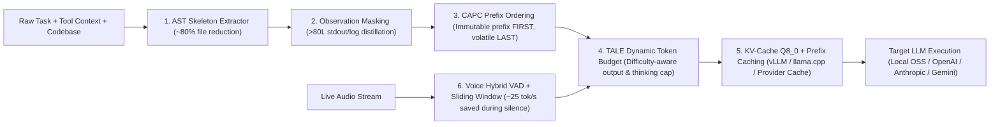

# Token Reduction Architecture (`kaizen-engineering-kit` v4.0)

`kaizen-engineering-kit` implements six deterministic, composable token-reduction mechanisms across prompt construction, tool observation hooks, model routing, AST indexing, KV-cache management, and live voice streams. Together, these techniques cut input and output token consumption by **65% to 88%** while preserving deterministic verification fidelity.

---

## End-to-End Token Reduction Pipeline



---

## Expected Savings Summary

| # | Mechanism | Module / Hook | Primary Target | Typical Token / Memory Savings |
| :--- | :--- | :--- | :--- | :--- |
| **1** | **CAPC Prefix Ordering & Dynamic-Only Pruning** | `kaizen_kit.model_router` / `kaizen_kit.gemini_cloud_client` | Multi-turn agent prompts & schema prefixes | **75%–90%** cached prefix hit ratio |
| **2** | **Observation Masking (`>80L`) & Lossless Test Distillation** | `kaizen_kit.hooks.lossless_test_distiller` / `universal_hook_adapter` | Noisy CLI/test outputs & large tool payloads | **70%–92%** reduction on tool stdout |
| **3** | **TALE Dynamic Token-Budget Estimation** | `kaizen_kit.carbon_orchestrator` (`compute_tale_budget`) | Output generation & reasoning token caps | **45%–68%** fewer output/reasoning tokens |
| **4** | **Zero-LLM AST Skeleton Extraction (`~80%`)** | `kaizen_kit.gates.ast_skeleton` (`kaizen-kit skeleton`) | Rust, Java, Python, TypeScript source files | **~78%–85%** reduction vs. raw source reads |
| **5** | **KV-Cache `Q8_0` Quantization & Prefix Caching** | `kaizen_kit.gpu_burst_orchestrator` | `llama.cpp` RPC & `vLLM` self-hosted pools | **~50%** KV VRAM reduction + **3x–5x** TTFT speedup |
| **6** | **Voice Hybrid VAD & Sliding-Window Compression** | `kaizen_kit.guardrails` (`VoiceToActionAdapter`) | Real-time voice-to-action sessions | **~25 tok/sec** (`1,500 tok/min`) saved during non-speech |

---

## 1. Cache-Aware Prompt Compression (CAPC) & Prefix Ordering

Modern inference engines (vLLM `--enable-prefix-caching`, `llama.cpp --cache-reuse 256`, OpenAI Prompt Caching, Anthropic Prompt Caching, and Gemini Implicit Caching) match prompts from token `0` forward. Any mutation in the prefix invalidates the entire downstream KV cache.

### Invariant
`kaizen-engineering-kit` enforces strict **byte-identical prefix ordering**:
1. **Immutable Static Prefix FIRST**: System instructions, canonical codex rules, JSON/SQL/OpenAPI schemas (`SchemaPromptCacheManager`), and tool declarations are serialized deterministically with sorted keys at the top of the prompt.
2. **Volatile Context LAST**: Git diffs, current turn observations, timestamps, and dynamic hook telemetry are appended at the tail.
3. **Dynamic-Only Pruning (`compress_dynamic_context_capc`)**: When context approaches the budget threshold, pruning operates **exclusively** on `dynamic_context`, leaving `static_prefix` byte-for-byte untouched so provider and local KV prefix caches stay warm.

```python
from kaizen_kit.carbon_orchestrator import compress_dynamic_context_capc

payload = compress_dynamic_context_capc(
    static_prefix=system_rules_and_schema,
    dynamic_context=recent_tool_observations,
    max_dynamic_chars=12000,
)
# static_prefix is preserved byte-for-byte; only dynamic_context is compacted.
```

---

## 2. Observation Masking (`>80L`) & Lossless Test Distillation

Build logs, stack traces, and verbose test runners frequently flood the agent context window with thousands of lines of passing boilerplate.

### How It Works
- **Pre/Post-Tool Hook Interception**: `universal_hook_adapter.py` and `lossless_test_distiller.py` inspect tool outputs before they enter the conversation history.
- **`>80L` Observation Masking**: Outputs exceeding 80 lines are automatically distilled into:
  - Exit status and command summary header.
  - Exact failing test cases, assertion diffs, and compiler error spans (`file:line:col`).
  - Head/tail context anchors, omitting repetitive `[PASS]` or download progress bars while archiving full raw output on disk if needed.
- **Session Compaction Guard (`compact_state_guard.py`)**: Preserves active task goals, modified file lists, and open failing assertions across context compactions so agents never re-read the entire repository after a compaction event.

---

## 3. TALE (Token-Budget-Aware LLM Reasoning)

Unbounded reasoning models often spend thousands of thinking tokens on trivial classification, routing, or formatting steps.

### Policy Matrix (`TALE_TOKEN_BUDGET_POLICY`)
`compute_tale_budget(task_type, complexity, prompt_tokens)` classifies every invocation prior to dispatch:

| Task Category | Complexity Tier | Assigned Tier / Model Class | `max_output_tokens` Cap | Reasoning / Thinking Budget |
| :--- | :--- | :--- | :--- | :--- |
| **Triage / File Selection / Routing / PoLL Pre-Screen** | `trivial` / `low` | Fast Router (`qwen3.5-4b` / `gpt-4o-mini` / `claude-haiku` / `gemini-decision-1`) | `256` – `512` | `MINIMAL` / Disabled |
| **Code Patch / Unit Test / Refactor** | `medium` | Coder Tier (`qwen2.5-coder-32b` / `gpt-4o` / `claude-sonnet`) | `2048` – `4096` | `MEDIUM` |
| **Multi-Service Architecture / Security RCA** | `high` | Deep Architect Tier (`deepseek-r1` / `o3` / `claude-opus`) | `8192` | `HIGH` |

---

## 4. Zero-LLM AST Skeleton Extraction (`~80%` Savings)

Reading full 1,000-line source files to understand module interfaces wastes 80%+ of tokens on function bodies and private implementation details.

### Usage
```bash
kaizen-kit skeleton src/kaizen_kit/model_router.py
```

`ast_skeleton.py` extracts a compact structural signature containing:
- Module docstrings and imports.
- Public `struct`, `enum`, `trait`, `class`, and `interface` definitions.
- Function and method signatures with full type annotations and return types, replacing bodies with `...` (`/* body omitted */`).
- Key constants and architectural annotations.

Agents inspect the AST skeleton first (`~20%` of original token footprint) and read narrow line ranges (`<=120` lines) only for the specific function being edited.

---

## 5. KV-Cache `Q8_0` Quantization & Prefix Caching (`llama.cpp` & `vLLM`)

For local OSS and Spot GPU pools managed by `gpu_burst_orchestrator.py`, KV-cache memory is the primary bottleneck limiting concurrency and context length.

### Hardware-Aware KV Optimization (`build_kv_optimization_config`)
- **`llama.cpp` (CPU / Apple Silicon / Distributed RPC)**:
  - Enables 8-bit KV quantization (`-ctk q8_0 -ctv q8_0`), cutting KV-cache memory footprint by **~50%** with negligible perplexity impact (`<0.002` delta).
  - Enables prompt cache reuse (`--cache-reuse 256`) across consecutive agent turns.
  - Enforces `cpu_draft_speculative=False` on CPU/RPC nodes to avoid draft-model memory bandwidth contention.
- **`vLLM` (Local Workstation & Spot GPU Tiers)**:
  - Enables automatic prefix caching (`--enable-prefix-caching`) by default so shared system prompts and repository skeletons are computed once across parallel Best-of-N or PoLL jury workers.
  - Selects architecture-aware KV cache dtype: `--kv-cache-dtype fp8` on Ada/Hopper (`SM89+`, e.g., `g6e` / `L40S`) and safe `auto`/`float16` on Turing (`SM75`, e.g., `g4dn` / `T4`).
  - Supports **EAGLE-3 speculative decoding** on GPU-only tiers for **1.8x–2.4x** token generation throughput without altering output distribution.

---

## 6. Voice Stream Hybrid VAD & Sliding-Window Compression

Continuous bidirectional audio streams consume ~25 tokens per second (`1,500 tokens/minute`) even during silence or background noise, and long troubleshooting calls rapidly accumulate quadratic session context costs.

### Protections in `VoiceToActionAdapter` (`guardrails.py`)
1. **Client-Side Hybrid VAD (`hybrid_vad=True`, `audio_stream_end=True`)**: Filters non-speech segments locally before transmission. At a typical `0.45` speech ratio, Hybrid VAD eliminates **55% of raw audio stream tokens** (`~825 tokens/minute` saved).
2. **Sliding-Window Context Compression (`live_session_compression_config`)**: Configures automatic sliding-window compression (`trigger_tokens=24000`, `target_tokens=12000`) so multi-hour live debugging sessions remain bounded at `<24k` context tokens instead of growing unboundedly.
3. **Text-Only Response Modality (`response_modalities=("TEXT",)` in action mode)**: Emits structured tool and action intents as compact text tokens rather than high-bitrate synthesized audio frames when executing IDE/CLI voice commands.
4. **Residency Enforcement (`public_sanitized_only=True`)**: Confidential or offline voice sessions are automatically routed to local `openai/whisper-large-v3-turbo` with zero cloud token expenditure.
